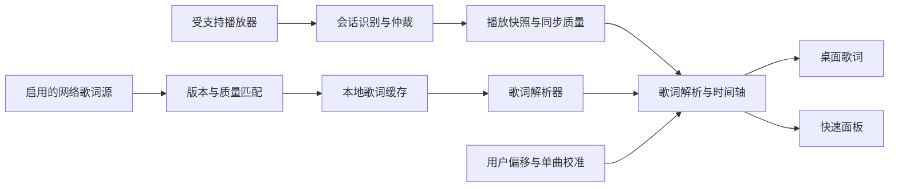

# 词间 · Lyrveil 产品设计规范

文档版本：1.1  
基线应用版本：0.2.0  
最后更新：2026-08-31  
状态：实施中的产品主规范

## 1. 产品定义

词间是一款低干扰、常驻托盘的 Windows 桌面歌词工具。它不替代音乐播放器，只完成三件事：

1. 识别用户正在使用的受支持播放器与当前歌曲；
2. 为歌曲选择尽可能准确的歌词与时间线；
3. 以可穿透、可隐藏、可快速调节的悬浮层显示歌词。

产品承诺不是“所有播放器都能精确同步”，而是：**准确说明当前同步能力，在数据足够时精确跟随，在数据不足时安全降级，并允许用户快速校准。**

## 2. 目标用户与核心任务

### 2.1 目标用户

- 在 Windows 上使用 QQ 音乐、网易云音乐、酷狗音乐、Apple Music 或 Spotify 的用户；
- 希望歌词始终可见，但不希望播放器窗口长期占用屏幕的用户；
- 对逐字歌词、现场版、混音版、翻唱版等版本匹配有要求的用户；
- 需要点击穿透、多显示器、暂停隐藏或高自定义外观的用户。

### 2.2 核心任务

- 播放音乐后自动出现正确歌词；
- 暂停、切歌、拖动播放进度后，歌词状态可解释且尽量及时重对齐；
- 在自动匹配错误时，能看懂候选差异并手动固定正确版本；
- 用托盘或快速面板完成日常操作，不必进入完整设置；
- 在字体、背景、颜色或同步偏差不合适时快速修正。

### 2.3 非目标

- 不提供音乐播放、账号登录、歌单管理或下载音乐；
- 不承诺第三方实验歌词接口永久稳定；
- 不把普通逐行 LRC 伪装成真实逐字时间；
- 不在无法获取绝对播放位置时声称“精确同步”；
- 不默认上传播放历史、歌词内容或诊断信息。

## 3. 产品原则

1. **低干扰**：日常入口只保留桌面歌词、托盘与快速面板。
2. **状态诚实**：明确区分精确进度、本地计时、增强续时与无进度。
3. **安全降级**：播放器或歌词源失败不能影响播放器本身，也不能清空已有可用歌词。
4. **版本优先**：先校验歌名、歌手、专辑、版本特征与时长，再比较歌词质量。
5. **用户选择优先**：手动选择或导入的歌词不得被后台自动匹配静默覆盖。
6. **可恢复**：窗口跑到屏外、实验通道断线、缓存损坏或来源失效时都有回退路径。
7. **本机优先**：设置、缓存、校准与增强进度尽量留在本机。

## 4. 信息架构

| 表面 | 主要用途 | 打开方式 | 关闭方式 |
|---|---|---|---|
| 桌面歌词 | 持续显示当前句、第二句和进度 | 播放后自动出现 | 暂停隐藏、关闭显示或纯音乐自动隐藏 |
| 快速面板 | 高频开关、透明度、字号、全局/单曲校准、选词、导入 | 左键托盘图标 | 再次左键、关闭按钮或进入完整设置 |
| 托盘菜单 | 快速调节、显示歌词、完整设置、退出 | 右键托盘图标 | 失焦、Esc 或选择操作 |
| 完整设置 | 低频和高级设置 | 托盘菜单或快速面板 | 关闭时隐藏，不退出应用 |
| 播放器选择 | 配置后台监听或组合快捷方式 | 常规页对应操作 | 取消或保存 |
| 歌词选择 | 搜索、比较并固定歌词版本 | 来源页或快速面板 | 取消或使用所选歌词 |

完整设置固定为六个一级页面：常规、播放器与同步、显示、歌词、实验性功能、关于。需要额外启用且可能随播放器版本变化的能力（如网易云实验性精确进度）只在“实验性功能”中提示，不占用主播放器设置页。

## 5. 系统模型

播放器识别与歌词来源必须保持独立。例如，QQ 音乐正在播放时可以使用网易云、酷狗或 LRCLIB 的歌词。

## 6. 播放与同步状态

### 6.1 时间线质量

| 状态 | 含义 | UI 文案 | 可跟随拖动 |
|---|---|---|---|
| `Reported` | 播放器或增强通道提供当前绝对位置 | 精确同步 / 实验性精确进度 | 是 |
| `EnhancedEstimated` | 增强通道刚中断，从最后可靠锚点继续 | 增强本地续时 · 等待精确进度恢复 | 断线期间不保证 |
| `Estimated` | 只有本地计时，没有可靠的新绝对锚点 | 本地计时 · 拖动后可能需要校准 | 否 |
| `Unavailable` | 没有可靠进度 | 未获得播放进度 | 否 |

### 6.2 Seek 处理

- 收到可靠 seek 事件后立即切换到目标位置；
- Apple Music seek 后只在同一来源、会话与歌曲身份内判断新旧帧；目标位置已出现后的旧位置群不渲染，其他播放器或新的暂停快照也不得被误判为 Apple 旧帧；
- 网易云增强通道在 seek 后缓冲期间保持 `Playing` 语义，但将时间线冻结，避免歌词继续前进或触发“暂停隐藏”；
- 收到连续、稳定的播放进度后解除冻结；
- 通道短暂中断时仅在同一首歌严格匹配后继承最后锚点；
- 新歌、其他播放器或身份冲突时禁止继承旧位置。

### 6.3 播放器仲裁

- 只从明确白名单中选择会话；
- 实际出声是最强信号；没有音频样本时，明确的 `Playing` 必须高于“可用时间线 + Windows 当前会话”等弱提示；
- “当前出声”仅用于修正本帧播放/暂停状态；“近期出声”只用于短时保持会话选择，不得因尾音将真实暂停改回 `Playing`；
- 多个播放器同时打开时，暂停的播放器不能长期压过正在播放的播放器；
- 切换播放器时必须重新验证歌曲身份和进度来源；
- 浏览器媒体不进入桌面歌词匹配。

## 7. 歌词质量模型

| 质量 | 数据条件 | 视觉行为 | 候选标签 |
|---|---|---|---|
| 真实逐字 | 行内存在词/字时间点 | 按真实片段时间推进遮罩 | 逐字 |
| 普通逐行 | 只有每行开始时间 | 在本行到下一行之间平顺扫过；不是语义逐字 | 逐行 |
| 翻译 | 某行带翻译字段 | 第二行优先显示翻译 | 含翻译 |
| 纯音乐 | 来源或文件明确标记 | 自动隐藏桌面歌词 | 纯音乐 |

“歌词渐变”开启时，真实逐字使用片段时间；普通 LRC 仅做视觉上的匀速行内渐变。关闭时，当前整行直接使用进度色。界面和文档不得把普通逐行渐变描述为真实逐字。

## 8. 自动匹配规则

### 8.1 必须优先校验

1. 标准化后的歌曲名；
2. 主歌手与合作歌手；
3. 专辑名；
4. 时长；
5. 版本特征。

### 8.2 版本特征

支持识别并优先匹配 Live/演唱会、Remix、伴奏/Instrumental、翻唱/Cover、Demo、DJ、Acoustic、Radio Edit、Remaster 等特征。规则如下：

- 当前曲明确带版本特征时，候选必须优先带相同特征；
- 当前曲无版本特征时，标准发行版本优先；
- 专辑中的演唱会名称、年份或场次可作为二次校验；
- 多个现场版同时存在且播放器不给专辑/时长时，降低自动置信度并鼓励手选；
- 版本冲突不得被“有逐字歌词”抵消。

### 8.3 歌词质量偏好

完成身份与版本校验后：

- 开启歌词渐变：真实逐字候选优先；
- 关闭歌词渐变：不因逐字能力额外加分；
- 翻译、同步行完整度和无异常前置行作为次级质量信号；
- 候选排序后必须为首选项输出可核对的推荐依据，例如歌手/专辑是否相符、时长差、逐字能力与来源；不得把明显不同的歌手、专辑或时长误说为匹配；
- 手动选择始终覆盖自动偏好。

## 9. 核心流程

### 9.1 首次运行

1. 应用进入托盘，不强制弹出设置；
2. 检测支持的媒体会话；
3. 没有播放器时显示“等待播放器”，不请求网络歌词；
4. 首次识别歌曲后，先查本地缓存，再并行搜索已启用来源；
5. 自动结果写入专用歌词文件夹并带来源、选择方式和歌曲 ID 元数据。

### 9.2 自动获取歌词

1. 曲目身份稳定后开始解析；
2. 手选/导入缓存优先；
3. 自动缓存有精确来源 ID 时直接复用；
4. 否则并行搜索并全局评分；
5. 网络失败继续显示旧歌词或本地歌词；
6. 歌词加载、手选、导入与异步回填都使用包含歌名、歌手、专辑和取整时长的版本化操作身份；同名同歌手的标准版、Live 版等必须取消旧任务并分别加载；
7. 结果变化不能让桌面歌词短暂闪空。

### 9.3 手动选择歌词

1. 打开候选时自动带入当前歌名、歌手、专辑和时长；
2. 用户可修改歌名和歌手搜索不同版本；
3. 候选同时显示歌名、歌手、时长、专辑、来源和“逐字/逐行/翻译”质量；第一项标记为“首选”；
4. 列表顶部和读屏名称都说明首选依据，便于用户立即核对歌手、专辑、时长、逐字能力与来源；
5. 右侧预览最多展示足够核对内容，不暴露内部格式噪声；
6. 确认后写为 `manual`，以后自动搜索不能覆盖。

### 9.4 导入 LRC

- 支持 `.lrc` 和 `.lrcx`；
- 导入结果与当前曲绑定并写为 `import`；
- 读取失败、无同步行或曲目在操作期间变化时不覆盖当前歌词；
- 原文件不被移动或删除。

### 9.5 跟随播放器启动

- 整张模式行可点击，并提供明确键盘焦点；
- 当前模式的操作按钮显示“选择播放器…”或“创建快捷方式…”；
- 非当前模式显示“配置并启用…”，避免用户误以为只配置而不会切换模式；
- 保存后台监听配置后切换到监听模式；保存快捷方式后切换到快捷方式模式；
- 切换回后台监听时，仅恢复未被用户修改的原播放器快捷方式。
- 后台监听器不得将“已发起进程”等同于启动成功；它需在 4 秒确认期内观察主实例，失败或短时退出后按 2、4、8 秒递增并封顶 30 秒重试；稳定运行 30 秒后重置失败次数，播放器全部退出或用户关闭监听模式时停止该循环。

### 9.6 快速校准

网易云组合入口支持桌面和任务栏。用户可在“播放器与同步”开启“自动修复网易云更新后的同步”：更新重建普通入口后自动修复，另提供“网易云音乐 · 词间”桌面入口以便区分。已丢失精确进度的实例在持续暂停约 8 秒后尝试重开一次，播放中不打断，失败不循环重启。界面需说明播放位置可能重置，并显示等待、恢复或失败状态。此功能默认关闭；关闭组合方式或取消跟随网易云后停止维护，原有独立偏移保持不变。

- 播放器偏移：快捷面板只调当前播放器，显示播放器名称；切换时自动读取各自保存的值，即使歌曲信息相同也必须刷新，未连接或不支持时禁用；
- QQ 音乐、酷狗和 Spotify：各自独立保存 −3000～+3000 ms，正值提前、负值延后，新设置默认为 0；
- 所有播放器统一偏移：仅放在“高级校准”，影响所有播放器和歌曲，范围 −10000～+10000 ms，正值提前、负值延后；
- 网易云默认补偿：用户可在“播放器与同步 → 同步校准”设置默认延后量，范围 0～3000 ms，初始为 1000 ms；单独保存，只作用于网易云增强精确进度及断线续时；
- 网易云播放器偏移：在保存的默认补偿上微调，范围 −3000～+3000 ms，初始为 0。界面显示 0 ms 时仍使用默认补偿；正值提前、负值继续延后。默认延后 1000 ms 时，微调 0/+200/−200 ms 分别实际延后 1000/800/1200 ms；
- 旧设置升级：原有网易云延后量直接作为用户默认补偿，微调从 0 开始，避免重复补偿；旧版 0 ms 和原内置 120 ms 改用 1000 ms 基准。升级后显式保存的默认值（包括 0）和微调均原样保留；
- Apple Music 提前补偿：范围 0～3000 ms，只影响 Apple Music，正值让歌词更早；
- 本曲校准：范围 −10000～+10000 ms，只影响当前歌曲，按来源 ID 或专辑身份存储；
- 各播放器的偏移必须分别持久化并按当前播放来源选取，只应用一次，不得修改或叠加其他播放器的偏移；扩展范围不自动修改已有校准值。
- 快捷面板使用正值提前、负值延后的统一显示，网易云的“延迟”在这里显示为负值；设置页保留网易云与 Apple Music 原有方向和范围。

## 10. 界面详细规范

### 10.1 完整设置

- 默认尺寸 1000 × 665 DIP；在当前鼠标所在显示器居中；
- 小屏允许缩小并由页面独立滚动；
- 窗口移出可见工作区时自动恢复；
- 顶部固定显示当前歌曲、播放器与歌词/同步状态；
- 左侧仅放五个一级页面，不新增二级树。

### 10.2 常规

- 第一张卡：显示歌词、暂停隐藏、置顶；
- 第二张卡：两种伴随启动模式；
- 退出行为作为两种模式共用 footer，与顶部三项勾选框使用同一页面左轴；
- 模式选择行、单选圆点、标题与操作按钮必须语义一致。

### 10.3 歌词显示

- 显示行为、位置、文字、实时预览、颜色与背景按使用顺序排列；
- 背景透明度允许 0%，0% 即无背景，不再另设重复开关；
- 字体列表以系统可用字体为主，内嵌 Noto Sans CJK SC 作多语言兜底；
- 预览覆盖中文、英文、日文、韩文和西文；
- 重置显示设置必须明确不影响歌词源、同步偏移和单曲校准。

### 10.4 歌词来源

- 本地缓存固定置顶且不可关闭；
- 每个网络来源显示稳定性、能力和启用状态；
- Musixmatch 未配置时不可交互，不发请求；
- 搜索、重新自动匹配、文件夹和同步校准按任务分卡；
- 目录迁移只处理受管理歌词文件，绝不移动或删除普通用户文件。

### 10.5 歌词过滤

- 开关、每行一条规则、实时校验、恢复默认；无效正则按原始输入精确行号提示，空行不得导致行号偏移；
- 过滤只作用于显示副本；
- 局部替换导致字符索引变化时，该行退回逐行同步；
- 输入框需要屏幕阅读器名称和错误状态播报。

### 10.6 关于

- 动态显示程序集版本；
- 显示播放器与歌词/同步运行状态；
- 提供不含歌曲名、歌手、歌词内容和歌词路径的诊断摘要；本地播放器只显示可识别的文件名，不显示完整本地路径；
- 清楚说明本机数据、网络歌词请求和网易云实验通道边界；
- 未来加入许可证、第三方声明与更新通道后继续放在此页。

### 10.7 快速面板

- 固定深色表面，宽 380 DIP，位于托盘所在显示器工作区右下；
- 再次左键托盘图标收起；
- 不因点击面板内部而自动失焦隐藏；
- 候选列表显示质量标签和首选推荐依据；
- 所有图标按钮和滑块提供 Automation Name/HelpText；
- 选词搜索取消时必须取消网络任务，旧结果不得回灌。

### 10.8 托盘菜单

- 使用与快速面板相同的深色表面、边框、圆角和排版密度；
- 正文 13 DIP，图标 16 DIP，行高 42 DIP；
- 快速调节、显示歌词、完整设置、分隔线、退出；
- 退出只在悬停/键盘焦点时使用危险色；
- 自动避开当前显示器任务栏并支持上下键、Enter、Esc。

### 10.9 桌面歌词

- 内容尺寸窗口，不创建全屏透明覆盖层；
- 锁定时点击穿透且不激活；
- 解锁时可拖动并记忆位置；
- 屏幕变化后若位置不可见，自动回到当前显示器下方居中；
- 背景颜色和透明度只影响背景，歌词与进度保持清晰；
- 当前行和第二行均需避免超出工作区。

## 11. 视觉系统

### 11.1 颜色

- 主强调色：`#168F84` / 深色表面的 `#75E0D6`；
- 主文字：浅色界面 `#15171B`，深色界面 `#E8EBEF`；
- 次文字：浅色界面 `#686D76`，深色界面 `#9298A2`；
- 浅色卡片：白色，边框 `#E0E3E7`；
- 深色表面：`#F2181A1F`，边框 `#34373E`；
- 危险操作：只在交互态使用 `#FF8E92`；
- 状态不能只靠颜色表达，必须同时有文字、图标或选中标记。

### 11.2 字体

- 应用 UI：Segoe UI Variable Text / Segoe UI，中文由系统字体回退；
- 托盘菜单与需要稳定中文笔画的深色浮层：Microsoft YaHei UI；
- 正文 12–13 DIP，分区标题 15 DIP，页面标题 18 DIP；
- 不人为增加中文字符间距。

### 11.3 几何与间距

- 设置卡片圆角 10–12 DIP；浮层圆角 16 DIP；
- 复选框视觉 16 DIP，整行点击高度至少 28 DIP；
- 小按钮最小高度 34 DIP；主要行目标高度至少 40 DIP；
- 8 DIP 为基础间距，常用组合为 8/12/16/24。

## 12. 无障碍与键盘

- 所有 TextBox、ComboBox、Slider、颜色按钮、图标按钮必须有可读名称；
- 自定义候选列表项必须朗读标题、歌手、专辑、时长、来源和质量；
- 焦点态不得改变控件几何或边框厚度；
- Tab 顺序按视觉顺序，RadioButton 支持方向键，Esc 关闭浮层/对话框；
- 重要异步状态用 polite live region，不频繁朗读每句歌词；
- 高对比度模式是发布前必须补齐的专项，而不是由自定义颜色自动推断支持；
- 目标：正文和背景达到 WCAG AA 对比度，非文本控件边界达到 3:1。

## 13. 多显示器与 DPI

- 所有位置计算使用目标显示器工作区和对应 DPI；
- 快速面板、托盘菜单按鼠标/托盘所在显示器定位；
- 设置窗口首次打开在鼠标显示器居中；
- 悬浮歌词恢复保存位置前检查至少一部分可见；
- 验收缩放：100%、125%、150%、200%；
- 验收拓扑：主屏左/右、负坐标、任务栏四边、拔出显示器、改变分辨率。

## 14. 数据、隐私与安全

### 14.1 本地数据

- 设置：`%LocalAppData%\LyricsXQuiet\settings.json`；
- 默认歌词：用户音乐目录下的 `Lyrveil Lyrics`；
- 歌词写为可读增强 LRC，带 source、selection、歌曲身份元数据；
- 不记录逐次播放历史。

### 14.2 网络

- 只有启用的歌词源在匹配时联网；
- 不提供账号登录或上传用户库；
- 诊断摘要不含歌曲名、歌手、歌词、歌词路径或本地播放器的完整程序路径；
- 无遥测是当前默认策略，未来若增加必须显式选择加入。

### 14.3 网易云实验通道

- 仅绑定 `127.0.0.1` 随机端口；
- 不写入网易云安装目录，不加载第三方 DLL，不保存页面内容；
- Chromium 调试接口本身没有应用级认证，其他本机进程理论上可以访问，这是实验功能必须保留的安全提示；
- 长期正式方案应使用受当前用户 ACL 保护、具备身份验证的专用本机通道。

## 15. 性能目标

- 桌面歌词刷新：约 50 ms 一帧，但不每帧访问播放器或网络；
- 播放器监听：事件优先，自适应安全复查 1–10 秒，30 秒全量自愈；
- 后台启动监听：仅在已选播放器运行时唤醒主应用，并以实例确认和有上限的退避避免启动失败后高频重试；
- 网易云增强采样：仅在已启用并连接时运行，拖动/状态变化优先发布；
- 歌词搜索并行但可取消；隐藏候选面板或切歌后立即取消旧请求；
- 空闲状态不应固定每 0.5 秒重建所有媒体会话订阅；
- 发布前目标：空闲 CPU < 1%，常驻内存可解释且无持续增长。

## 16. 错误与空状态

| 场景 | 用户可见反馈 | 恢复路径 |
|---|---|---|
| 无播放器 | 等待播放器 | 启动受支持播放器 |
| 有歌曲无进度 | 未获得播放进度 | 本地计时、播放器设置或增强通道 |
| 无歌词 | 未找到歌词 | 重试、手选、导入 LRC |
| 来源失败 | 保留当前/本地歌词并说明失败 | 其他来源或稍后重试 |
| 精确通道断线 | 增强本地续时 | 自动重连，恢复后重锚 |
| 正则错误 | 输入处显示精确错误行号，不应用无效规则 | 修正规则或恢复默认 |
| 缓存损坏 | 忽略损坏文件，不崩溃 | 自动搜索或手动导入 |
| 窗口屏外 | 自动恢复到当前工作区 | 一键居中 |

## 17. 当前实施状态

### 17.1 已完成

- 五播放器白名单、浏览器排除和多播放器仲裁；
- 事件优先的 GSMTC 监听与时间线校准；
- GSMTC 强弱信号分层仲裁，以及“当前出声修正状态 / 近期出声稳定选择”分离；
- Apple Music seek 旧帧隔离、同来源/会话/歌曲身份限定和跨播放器锚点保护；
- 网易云 3.1.37 实验性精确进度、seek 冻结、断线续时与精确歌曲 ID；
- 网易云增强快照的歌曲 ID、专辑和时长严格合并防串歌，以及 CDP 多页面排序、上次成功页优先和失败回退；
- QQ 音乐拖动跳转实机通过；
- LRC/LRCX/增强 LRC、翻译、KRC/YRC 转换与可回读缓存；
- 全来源并行匹配、版本特征、专辑、时长和逐字偏好；
- 手动选词、导入、自动缓存升级和单曲校准；
- 按歌名、歌手、专辑和时长区分版本的歌词操作身份，避免同名不同版本的异步结果互相覆盖；
- 安全歌词目录迁移；
- 多显示器定位与屏外恢复；
- 托盘左右键、快速面板、播放器伴随启动与单实例转发；
- 后台监听的主实例启动确认、有上限指数退避和模式关闭停止；
- 可靠退出：停止定时器后将内存中最新监听配置排到最后应用，设置保存、监听注册、IPC、窗口、播放服务、歌词来源和单实例锁独立清理，单个步骤失败不留下半退出进程；
- 候选质量标签与首选推荐依据、正则错误精确行号、控件无障碍名称、动态状态读屏提示、清晰的模式操作语义和隐藏本地完整路径的安全诊断摘要。

### 17.2 部分完成

| 项目 | 当前状态 | 下一验收 |
|---|---|---|
| 酷狗播放器进度 | 能识别元数据，当前版本不发布可靠时间线 | 寻找公开/稳定进度通道或明确保持逐行降级 |
| Apple Music | 代码已识别，未实机矩阵验收 | 标题、专辑、时长、状态、seek、切歌 |
| Spotify | 代码已识别，未实机矩阵验收 | 标题、专辑、时长、状态、seek、切歌 |
| QQ 音乐 | seek 已通过 | 补切歌事件与多播放器交接实测 |
| 高对比度 | 系统控件部分可用，自定义表面未专项适配 | SystemColors 主题与屏幕阅读器回归 |
| 自动化 UI 测试 | 核心/平台冒烟已覆盖 | 新增 WPF STA 行为与截图回归 |

### 17.3 未实现

- 安装包、代码签名、自动更新和卸载数据策略；
- 全局快捷键及冲突检测；
- Musixmatch API 配置；
- 完整国际化/本地化；
- 应用内更新日志、许可证页和第三方声明入口；
- 可恢复的旧版“未标记手选缓存”迁移策略；
- 崩溃诊断文件导出与隐私审查；
- 正式发布许可证选择。

## 18. 优先级路线图

### P0：发布阻断

1. Apple Music、Spotify、QQ 切歌的实机兼容矩阵；
2. WPF 关键流程自动化：托盘切换、选词、目录迁移、播放器模式；
3. 高对比度和 Narrator 验收；
4. 安装、卸载、签名与更新方案；
5. 明确项目许可证和实验通道免责声明。

### P1：高价值体验

1. 兼容性诊断页显示各播放器的元数据、状态和时间线可用性；
2. 单曲校准在候选更换后明确提示是否保留；
3. 提供可撤销的自动歌词升级或缓存备份。

### P2：扩展

1. 全局快捷键；
2. Musixmatch；
3. 主题与国际化；
4. 更完整的歌词来源健康状态；
5. 用户显式选择的匿名错误报告。

## 19. 验收矩阵

### 19.1 功能

- 播放、暂停、恢复、前后拖动、连续 seek、切歌；
- 同播放器不同版本、同名不同歌手、Live/Remix/Demo/Cover；
- 本地缓存、网络结果、手选、导入、重启回读；
- 逐字、逐行、翻译、纯音乐；
- 多播放器同时打开和交替播放；
- 断网、来源失败、增强通道断开与恢复。

### 19.2 界面

- 设置默认、最小、最大可用尺寸；
- 100/125/150/200% DPI；
- 主屏/副屏/负坐标/拔屏；
- 鼠标、Tab、方向键、Space、Enter、Esc；
- Narrator 与 Accessibility Insights；
- 高对比度与系统文本缩放。

### 19.3 数据安全

- 目录迁移只处理歌词文件；
- 手选/导入不被自动覆盖；
- 异常中断时设置和缓存保持可恢复；
- 诊断摘要不含歌曲、歌词、歌词路径或本地播放器的完整程序路径；
- 实验通道失败时回到原生播放会话而不是控制播放器。

## 20. 文案词汇表

- **播放器**：提供当前歌曲和播放状态的软件；
- **歌词来源**：提供歌词内容的服务或本地文件；
- **逐字**：有真实行内时间点；
- **逐行**：只有每行开始时间；
- **精确同步**：有可重新校准的绝对播放位置；
- **本地计时**：从已有观察点按本机时钟推进；
- **增强本地续时**：增强通道中断后从最后可靠锚点继续；
- **播放器偏移**：只调整对应播放器并分别保存；
- **所有播放器统一偏移**：高级校准中所有播放器共同叠加的调整；
- **播放器延迟**：只补偿某个播放器/通道；
- **本曲校准**：只调整一首歌。

## 21. 变更记录

- 2026-08-31：落地 Apple seek 旧帧与跨播放器保护、版本化歌词操作身份、网易云 bridge 防串歌与 CDP 多页回退、GSMTC 优先级与音频状态分离、后台启动确认/退避、可靠退出、正则精确行号、候选首选依据和诊断路径隐藏；这些改进已纳入自动化覆盖，不替代 Apple Music、Spotify、QQ 切歌和网易云新版本的完整实机验收。
- 2026-08-13：建立完整产品主规范；纳入同步质量、版本匹配、候选质量、启动生命周期、无障碍、隐私、安全、性能、发布与验收要求。
